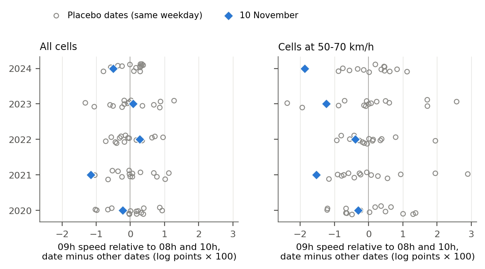

# The remembrance stop in traffic data

**Istanbul at 09:05 on 10 November, 2020–2024**

Every 10 November at 09:05 sirens sound across Turkey for Atatürk, and many drivers stop on the
road for the *saygı duruşu*. This repository measures how that stop shows up in Istanbul's open
traffic data, and holds the paper, the code that produces every number in it, and the derived
results.

**Paper:** [`paper/main.pdf`](paper/main.pdf) · **Author:** Mehmet Sami Boz



*Speed in the 09:00 hour relative to 08:00 and 10:00, each date minus the other dates of its year.
Diamonds are 10 November; circles are same-weekday placebo dates.*

## Findings

- **No city-wide effect.** Averaged over about 2,300 one-kilometre cells, the 09:00 hour on
  10 November is within the range of ordinary dates (0.18 full-stop-equivalent minutes, p = 0.12).
- **A slowdown on free-flowing arterials.** In cells that usually flow at 50–70 km/h, the 09:00
  hour lies below its neighbours in all five years: 0.64 minutes (p = 0.003; 0.015 after
  adjustment for four speed classes). The precision-weighted fixed-effects regression gives 0.57
  minutes (p = 0.002).
- **Sensitive to the reference hour.** The 10:00 hour was itself fast on 10 November. Against hours
  that do not adjoin the siren, the estimate is 0.41–0.43 minutes (p ≈ 0.06–0.10), slower in all
  five years with precision weighting.
- **A political gradient on local streets.** On slow streets (below 30 km/h), cells in
  neighbourhoods with a higher CHP vote in the 2023 parliamentary election slow more at 09:00, in
  all five years (p = 0.0007). District-level votes show only a weak version.
- **A lower bound.** The data contain no stationary vehicles (the lowest recorded speed is 1 km/h,
  6 km/h in 2020), so the minutes measure braking, crawling and restarting, not the full stop.

Full-stop-equivalent minutes are 60·(1 − e^D): the minutes for which every vehicle would have to
stand still to slow the hour by the measured amount.

### Main table

Generated by `scripts/06_paper_assets.py` from `data/derived/`.

<!-- results:start -->
| Usual 09h speed (km/h) | Cells | Effect (log points ×100) | Full-stop minutes | 90% interval (min) | Years negative | p | p (stepdown) |
|---|---:|---:|---:|---:|---:|---:|---:|
| All cells | 2,305 | -0.30 | 0.18 | -0.07 to 0.43 | 3 of 5 | 0.116 |  |
| < 30 | 518 | -0.06 | 0.04 | -0.42 to 0.47 | 2 of 5 | 0.441 | 0.718 |
| 30–50 | 608 | -0.44 | 0.26 | -0.12 to 0.65 | 3 of 5 | 0.133 | 0.328 |
| 50–70 | 391 | -1.07 | 0.64 | 0.26 to 1.05 | 5 of 5 | 0.003 | 0.015 |
| ≥ 70 | 788 | -0.02 | 0.01 | -0.32 to 0.36 | 3 of 5 | 0.486 | 0.718 |

Reference-hour check, 50–70 km/h cells: against 08:00 only 0.32 min (p = 0.208); against 10:00 only 0.93 min (p = 0.008); against 06, 07, 11, 12 0.43 min (p = 0.101). 79 dates, 983,040 assignments.
<!-- results:end -->

## Method in brief

1. **Within-day contrast.** For each cell and day, `c = ln v(09) − ½[ln v(08) + ln v(10)]`, which
   removes anything that shifts a whole morning.
2. **Placebo dates.** For each year the pool holds 10 November and every other date of the same
   weekday within ±8 weeks, without public holidays and the schools' autumn break.
3. **Inference over dates, not cells.** Cells are strongly correlated within a day, so
   significance is the share of all assignments of one date per year (983,040, enumerated exactly)
   that give a value as low as 10 November's. Romano–Wolf stepdown adjusts for the four speed
   classes.
4. **Regression version.** Cell-by-date and cell-by-hour fixed effects, school-break hours, rain and
   temperature, with cells weighted by the inverse of their residual variance on days outside the
   pool, so that noisy cells count less without down-weighting the event itself.
5. **Political gradient.** Each traffic cell gets the area-weighted CHP share of the neighbourhoods
   it overlaps; the slope of the cell response on that share is tested over the same placebo dates.

## Data

All inputs are public. Raw files are not committed; the scripts download them.

| Source | Content |
|---|---|
| İBB Açık Veri Portalı, *Saatlik Trafik Yoğunluk Veri Seti* | hourly speed and vehicle counts per geohash-6 cell, Jan 2020 – Jan 2025 |
| İBB traffic index web service | city-wide congestion index, 5-minute, Sep–Nov 2026 (tidy copy committed) |
| TÜİK election statistics | votes by neighbourhood: 2023 parliamentary, 2024 metropolitan mayoral |
| Land-registry neighbourhood polygons; OpenStreetMap | neighbourhood and district boundaries |
| Open-Meteo archive | hourly rain and temperature, central Istanbul |

Details, quirks and licences: [`data/README.md`](data/README.md).

## Reproduce

Python 3.10 or later and a LaTeX installation.

```bash
python -m pip install -e ".[dev]"
python -m playwright install chromium          # only for the TÜİK election downloads
python scripts/01_download_ibb.py               # 61 monthly files, weather, districts; rerun until none missing
python tools/tuik_genel_istanbul.py             # 2023 parliamentary votes by neighbourhood
python tools/tuik_yerel_bolge.py                # 2024 mayoral votes by neighbourhood
python scripts/02_build_panels.py
python scripts/03_estimate.py
python scripts/04_index_2026.py
python scripts/05_figures.py
python scripts/07_regression.py
python scripts/09_huber.py
python scripts/10_tails.py
python scripts/08_residuals.py
python scripts/11_residuals_compare.py
python scripts/06_paper_assets.py               # tables and number macros for the paper
cd paper && pdflatex main && bibtex main && pdflatex main && pdflatex main
pytest                                          # synthetic-data tests and a regression test against the pilot
```

The neighbourhood boundaries come from land-registry polygons prepared for another project; export
them to `data/raw/aux/istanbul_mahalle.geojson` (805 Istanbul polygons with `ilce_adi`,
`mahalle_adi`, `mahalle_id`). The İBB five-minute index keeps only the latest 60 days, so the 2026
series is committed in `data/derived/traffic_index_5min_2026.csv`.

## Repository layout

```
paper/          main.tex, main.pdf, generated tables/ and numbers.tex, references.bib
src/saygi/      bulk.py, panel.py, calendar.py   data download, panels, event and placebo dates
                pooled.py, dateri.py             date-level statistics, placebo-date inference
                regress.py                       fixed effects, precision weights, Huber
                geo.py, aux.py, plots.py         districts, neighbourhoods, votes, figures
                ibb.py, did.py, inference.py     pilot design, kept for the regression test
scripts/        01–11, the analysis pipeline
tools/          TÜİK election downloaders (Playwright)
data/derived/   aggregated results (CSV, JSON)
figures/        figures of the paper (PDF, PNG)
literature/     reference list and full-text reading notes with page numbers
tests/          synthetic-data tests
```

## Licence and attribution

Code: MIT ([LICENSE](LICENSE)). Text, figures and derived tables: CC BY 4.0
([LICENSE-CONTENT.md](LICENSE-CONTENT.md)).

Traffic data: İBB Açık Veri Portalı, under the [İBB Open Data License](https://data.ibb.gov.tr/license).
"Atıf 4.0 Uluslararası (CC BY 4.0) kapsamında lisanslanan kamu sektörü bilgilerini içerir."
Election data: TÜİK. Weather: [Open-Meteo](https://open-meteo.com) (CC BY 4.0). District
boundaries: © OpenStreetMap contributors (ODbL). This project is not endorsed by İBB or TÜİK.

## Citation

```bibtex
@misc{boz2026saygi,
  author       = {Boz, Mehmet Sami},
  title        = {The remembrance stop in traffic data: Istanbul at 09:05 on 10 November, 2020--2024},
  year         = {2026},
  howpublished = {\url{https://github.com/msamiboz/saygi-durusu-traffic}}
}
```
